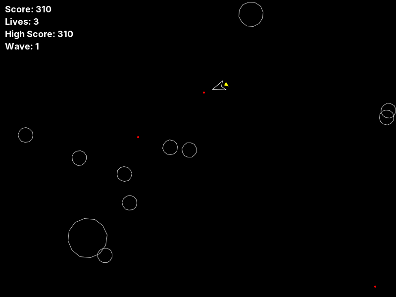

# Comets


An Asteroids-style arcade game in Java Swing. Fly the ship, shoot comets, and
watch large comets break into medium ones and medium into small. Clear the
field to start a bigger wave.



## Play

```sh
mvn -q package && java -jar target/comets-1.0.0.jar
```

Requires Java 17+. You can also run `comets.Comets` from any IDE.

| Key | Action |
|---|---|
| ↑ / W | thrust |
| ← → / A D | rotate |
| Space | fire (200 ms cooldown) |
| E | hyperspace jump to a random spot (10% chance it fails and costs a life) |
| R | restart after game over |

## How it works

- **Physics**:
  - Thrust follows the ship's heading.
  - Friction (×0.99 per tick) slows the ship.
  - Speed is capped at 8 px/tick, and the cap keeps the direction of travel.
  - Every object wraps around the screen edges.
- **Fixed-timestep loop**: game logic always advances in 1/60 s steps,
  separate from rendering, so it runs at the same speed on fast and slow machines.
- **Collisions**:
  - A bullet hits when it is inside a comet's radius.
  - Each bullet destroys at most one comet, worth 10 × the comet's size.
  - The ship is hit within the comet's radius + 10 px. It loses a life,
    respawns at the center, and remaining bullets are cleared.
- **High score**: saved to `highscore.txt` once per game, when the game ends.
  A missing or corrupt file just resets to 0.
- **Threading**: the game loop runs on its own thread and Swing handles input
  on the event thread. All game state lives in `GameWorld` behind one lock,
  and painting works from snapshots, so the two threads never see a
  half-updated frame.

## Design

```
GameObject            position, velocity, rotation, screen wrapping
├── Ship              thrust, friction, speed cap, fire cooldown
├── Bullet            fixed lifespan
└── Comet             spin, size, shatter into two smaller pieces
GameWorld             all game rules and state, no Swing (unit-testable)
GamePanel             rendering, keyboard input, the game loop
HighScoreStore        load/save the high score
Comets                main window
```

## Tests

```sh
mvn test     # 20 JUnit 5 tests, run headless in GitHub Actions
```

The tests cover:
- screen wrapping, thrust direction, friction, the speed cap and turning
- fire cooldown timing and where bullets spawn
- bullet lifespan
- comet sizes, scoring and shatter speed
- one-bullet-one-comet hits, ship collisions and respawn, game over
- the high score being written exactly once, persistence, and corrupt-file handling
- wave progression and hyperspace outcomes

## Background

This started as Assignment 8 in UCF's COP3330 (Object-Oriented Programming).
The course gave starter code: the class skeleton, rendering and the game loop.

What I implemented for the assignment:
- screen wrapping
- ship physics (thrust, friction, speed cap)
- bullet–comet and ship–comet collisions with shattering and scoring
- extra credit: a persistent high score and the hyperspace jump

After the course I reworked it:
- split the single file into one class per file
- moved the game rules out of the Swing panel into `GameWorld` so they could be unit tested
- made the fire cooldown and shatter randomness injectable for tests
- added the JUnit suite, a Maven build and CI
- added a wave counter

Bugs fixed along the way:
- after game over, the high score file was rewritten 60 times per second
- hyperspace could still be used after game over and push lives below zero
- key presses on the Swing thread could race the game loop when restarting
